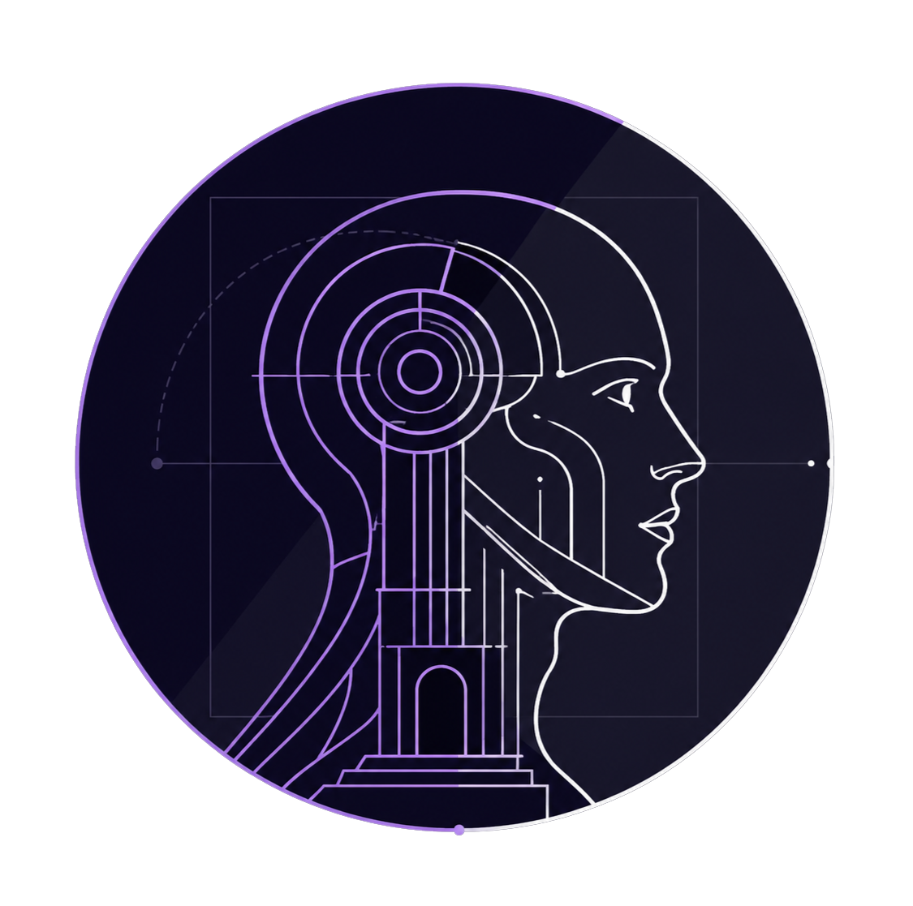
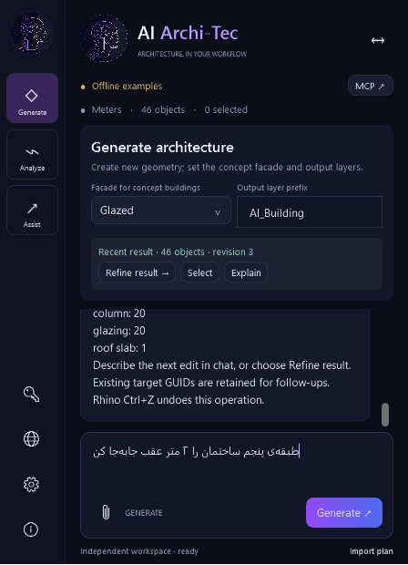
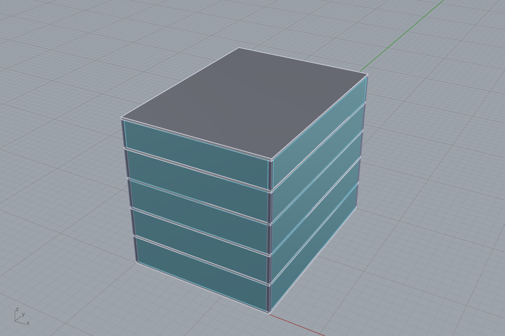
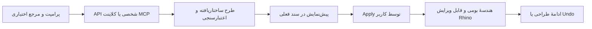

<p align="center"></p>
<h1 align="center">AI Archi-Tec for Rhino 8</h1>
<p align="center">دستیار مدل‌سازی معماری داخل راینو — با API شخصی یا اتصال محلی MCP</p>
<p align="center"><a href="docs/README.en.md">English</a> · <a href="docs/INSTALLATION.fa.md">راهنمای نصب</a> · <a href="docs/CONNECTIONS.fa.md">اتصال API و MCP</a> · <a href="https://github.com/MrHs6/ai-architec-rhino/releases">دانلودها</a></p>

[](https://github.com/MrHs6/ai-architec-rhino/actions/workflows/rhino-plugin.yml)


ایدهٔ معماری را در پنل **AI Archi-Tec** وارد کنید، طرح پیشنهادی را در همان سند راینو ببینید و با **Apply to Rhino** به هندسهٔ قابل ویرایش تبدیل کنید. برای استفاده از هوش مصنوعی، سرویس و کلید شخصی خودتان را تنظیم کنید؛ یا کلاینت دسکتاپ سازگار را به MCP محلی پلاگین وصل کنید.

**Beta: `0.4.0-beta.1` · Windows x64 · Rhino 8.31+ (.NET 8)**

نیازمند راینو ۸.۳۱ یا جدیدتر از شاخهٔ Rhino 8. این یک نسخهٔ آزمایشی برای مدل‌سازی مفهومی است؛ محدودیت‌ها و وضعیت آزمون‌ها پایین همین صفحه آمده‌اند.

در نسخهٔ 0.4، پروفایل API پیش از اتصال ذخیره و فعال می‌شود؛ خطای شبکه با وضعیت ذخیره مخلوط نمی‌شود. پس از Apply، چت نتیجهٔ واقعی را گزارش می‌کند و ادامهٔ ویرایش به همان مدل وصل است. [آموزش ساخت و ادامهٔ ویرایش](docs/CONVERSATIONAL-WORKFLOW.fa.md) · [بررسی پلاگین‌های مرجع](docs/REFERENCE-REVIEW.fa.md)

## دانلود و نصب سریع

**[دانلود نصب‌کنندهٔ ویندوز ZIP](https://github.com/MrHs6/ai-architec-rhino/releases/download/rhino-v0.4.0-beta.1/ai-architec-rhino-0.4.0-beta.1-windows-installer.zip)** · [دانلود مستقیم Yak](https://github.com/MrHs6/ai-architec-rhino/releases/download/rhino-v0.4.0-beta.1/ai-architec-rhino-0.4.0-beta.1-rh8_31-win.yak) · [صفحهٔ نسخه و فایل‌ها](https://github.com/MrHs6/ai-architec-rhino/releases/tag/rhino-v0.4.0-beta.1)

1. نصب‌کنندهٔ ZIP را دانلود و **Extract All** کنید؛ فایل‌ها را کنار هم نگه دارید.
2. سندتان را ذخیره و **تمام پنجره‌های راینو را ببندید**؛ سپس فایل **`install.cmd`** را اجرا کنید. این فایل ابزار رسمی **Yak** همراه راینو را فراخوانی می‌کند.
3. راینو را دوباره اجرا کنید.
4. در خط فرمان راینو بنویسید **`archtec`** و **Enter** بزنید.
5. در **Settings** سرویس، API Key و مدل خودتان را انتخاب کنید؛ یا از دکمهٔ **MCP** استفاده کنید.

برای نصب نسخهٔ آماده، **Visual Studio، Node و SDK لازم نیست**. کاربران نهایی فقط به راینو با لایسنس معتبر نیاز دارند. هزینه و دسترسی مدل آنلاین تابع سرویس انتخابی کاربر است؛ هیچ کلید یا اعتبار اشتراکی در بسته قرار ندارد.

نصب مستقیم در CMD نیز ممکن است:

```cmd
"%ProgramFiles%\Rhino 8\System\Yak.exe" install "D:\Downloads\ai-architec-rhino-0.4.0-beta.1-rh8_31-win.yak"
```

مسیر فایل را با محل دانلود خودتان جایگزین کنید. راه‌های دیگر نصب، مسیر سفارشی راینو، به‌روزرسانی، حذف و رفع خطا در **[راهنمای نصب فارسی](docs/INSTALLATION.fa.md)** توضیح داده شده‌اند.

## محیط واقعی پلاگین

<p align="center"></p>

تصویر بالا پنل واقعی نسخهٔ جدید است. نمونهٔ ساختمان پایین با حالت محدود **Offline examples** ساخته شده است؛ تصویر، مدرک آزمون مدل آنلاین نیست.



[دانلود فایل قابل ویرایش ساختمان نمونه 3DM](https://github.com/MrHs6/ai-architec-rhino/releases/download/rhino-v0.4.0-beta.1/demo-building.3dm) — ۴۶ جزء بومی راینو شامل دال‌ها، ستون‌ها، نما و بام.

## چه کارهایی انجام می‌دهد؟

| قابلیت | رفتار نسخهٔ فعلی |
|---|---|
| پنل داخل راینو | فرمان `archtec`، پنل قابل Dock و حالت شناور با `AIArchitectFloat` |
| API شخصی | پروفایل مستقل OpenRouter، OpenAI، xAI/Grok، Google Gemini، Anthropic/Claude و OpenAI-compatible/local |
| فضای کاری مستقل | Generate، Analyze و Model Assist هرکدام گزینه‌ها، ورودی، مرجع و مکالمهٔ جدا دارند |
| انتخاب مدل | فهرست مدل‌ها از سرویس دریافت می‌شود؛ شناسهٔ انتخابی بدون تعویض مخفی ارسال می‌شود |
| ورودی تصویر | ورودی بومی Gemini؛ OpenRouter، xAI و Anthropic طبق قابلیت تصویری اعلام‌شدهٔ مدل |
| ساختمان مفهومی | ساختمان مستطیلی چندطبقه با اجزای جدا، لایه‌بندی و مشخصات طبقه/نقش |
| مدل‌سازی پایه | باکس، خط، پلی‌لاین، منحنی و extrusion؛ جابه‌جایی، تغییر مقیاس، انتخاب و خواندن مشخصات |
| کنترل خروجی | اعتبارسنجی طرح، پیش‌نمایش در viewport، اجرای صریح با Apply و Undo در راینو |
| Analyze | گزارش محلی ابعاد، اعتبار/بسته‌بودن هندسه و لایه‌ها؛ انتخاب scope و تفسیر اختیاری AI، بدون تغییر هندسه |
| Model Assist | Move، Scale و Extrude روی انتخاب یا خروجی اخیر، با مقدار و محور مشخص و پیش‌نمایش قبل از Apply |
| تنظیمات و About | صفحات جدا برای API، MCP، Preferences و نمای کلی اتصال؛ معرفی سازنده با لوگوی اصلی |
| MCP محلی | سرور localhost با توکن و پل stdio برای کلاینت‌های دسکتاپ سازگار |
| تنظیمات مستقل | تنظیمات هر حساب ویندوز جداست؛ ذخیرهٔ اختیاری کلید با Windows DPAPI |

## روند کار



**Generate به‌تنهایی سند را تغییر نمی‌دهد.** ابتدا پیش‌نمایش را ببینید؛ با **Apply to Rhino** اجرا و با **Ctrl+Z در راینو** همان بستهٔ عملیات را برگردانید. سند، واحد یا هندسهٔ هدف که تغییر کند، باید طرح تازه تولید شود.

برای اولین آزمون بدون API، از این مثال محدود استفاده کنید:

```text
Create a 15 x 20 meter building with 5 floors and 3.2 meter floor heights and a glazed facade.
```

برای کار آزاد با زبان طبیعی باید مدل آنلاین سازگار را وصل کنید. حالت آفلاین فقط چند مثال عددی ساختمان، باکس و جابه‌جایی را می‌فهمد.

## اتصال API و MCP

صفحهٔ **API profiles** را از آیکون کلید باز کنید؛ هر سرویس کلید، نشانی و مدل مستقل دارد. **Connect and discover models** فهرست حساب همان سرویس را دریافت می‌کند. Grok از API مستقیم xAI، Gemini از GenerateContent و Claude از Anthropic Messages استفاده می‌کند؛ OpenRouter، OpenAI و سرویس سفارشی از قالب سازگار OpenAI استفاده می‌کنند. [تفاوت پروتکل‌ها و منابع رسمی](docs/PROVIDERS.md)

آیکون کره، **MCP connection** را باز می‌کند؛ آیکون چرخ‌دنده، **Preferences** را برای فضای کاری پیش‌فرض، تراکم مکالمه و Zoom پیش‌نمایش باز می‌کند. دکمهٔ دوطرفهٔ بالای پنل، نمای کلی اتصال را نشان می‌دهد. بخش **About the creator** سازنده و روند کار پروژه را معرفی می‌کند.

دکمهٔ **MCP** سرور `http://127.0.0.1:5188/mcp` را روی همان کامپیوتر روشن می‌کند. **Copy desktop client configuration** تنظیمات پل محلی را آماده می‌کند. کلاینت می‌تواند زمینهٔ سند را بخواند و طرح پیشنهاد کند؛ اجرای طرح همچنان با Apply در راینو است. **یک سرویس ابری به localhost ویندوز دسترسی مستقیم ندارد** و به کلاینت/پل سازگار روی کامپیوتر نیاز دارد. بازکردن سایت ChatGPT اتصال MCP را خودکار تنظیم نمی‌کند.

**[راهنمای کامل اتصال و نمونهٔ تنظیمات](docs/CONNECTIONS.fa.md)** · [نحوهٔ استفاده از داده‌ها](rhino-plugin/PRIVACY.md)

## وضعیت بتا و محدودیت‌ها

- **۶۷ آزمون خودکار** شامل سه پروتکل جدید، صفحه‌بندی مدل‌ها، ورودی تصویر، هدر کلید و استقلال workspaceها گذشتند. در نسخهٔ جدید، **۱۹ آزمون هندسه و ۲۰ بررسی رابط/گزارش/پروفایل** در خود راینو نیز گذشتند. چهار بررسی ساختمان و آزمون Apply/Undo از نسخهٔ قبلی ثبت شده‌اند.
- آزمایش پاسخ زندهٔ سرویس‌های پولی و کیفیت تفسیر تصویر با حساب واقعی هنوز تکمیل نشده است. آزمون کامل نصب تمیز و شروع مجدد روی دستگاه دوم نیز باقی است. [گزارش اعتبارسنجی](rhino-plugin/docs/VALIDATION.md)
- خروجی فعلی هندسهٔ مفهومی است. بازسازی دقیق هر تصویر، طراحی خودکار کامل هر ساختمان، BIM، نقشهٔ اجرایی، Grasshopper و حافظهٔ پایدار پروژه در این نسخه پیاده‌سازی نشده‌اند.
- این نسخه مخصوص Windows و Rhino 8 است؛ برای macOS، Rhino 7 یا همهٔ نسخه‌های اولیهٔ Rhino 8 بستهٔ سازگار ارائه نشده است.
- انتشار GitHub مستقل از Food4Rhino/Yak عمومی است؛ موجودبودن این مخزن به معنی درج در آن کاتالوگ‌ها نیست.

## سورس و توسعه

```powershell
git clone https://github.com/MrHs6/ai-architec-rhino.git
cd ai-architec-rhino\rhino-plugin
.\scripts\build.ps1 -UseNuGet
.\scripts\package.ps1
```

برای ساخت، Windows و **.NET SDK 8** لازم است. SDK رسمی Rhino با نسخهٔ مشخص از NuGet دریافت می‌شود؛ برای کامپایل، نصب راینو ضروری نیست. اجرای رابط و آزمون هندسه نیازمند راینو با لایسنس معتبر است. خروجی بسته‌ها در `rhino-plugin/artifacts/releases` قرار می‌گیرد.

GitHub Actions سورس را می‌سازد، آزمون‌ها را اجرا می‌کند و فایل نصب تولید می‌کند. تگ `rhino-v<version>` پیش‌نویس prerelease می‌سازد تا نگهدارنده آن را بازبینی و منتشر کند. قالب GitLab با Windows runner نیز در سورس موجود است. [راهنمای ساخت و انتشار](rhino-plugin/docs/DISTRIBUTION.md)

## پشتیبانی و معرفی

خطا یا پیشنهاد را در **[GitHub Issues](https://github.com/MrHs6/ai-architec-rhino/issues)** ثبت کنید؛ نسخهٔ Rhino، نسخهٔ پلاگین و مراحل بازتولید را بنویسید. کلید API و توکن محلی را در گزارش قرار ندهید.

آدرس مناسب برای معرفی در شبکه‌های اجتماعی: **https://github.com/MrHs6/ai-architec-rhino**

[متن آمادهٔ معرفی فارسی و انگلیسی](docs/SOCIAL-MEDIA.md) · [وب‌سایت پروژه](https://ai-arch.ir)

طراحی و مالکیت: **Hasan Sharif Askari**. سورس برای مشاهده منتشر شده است؛ مجوز متن‌باز برای تغییر یا بازتوزیع سورس تعیین نشده است. [وضعیت حقوق و مجوز](LICENSE.md)
