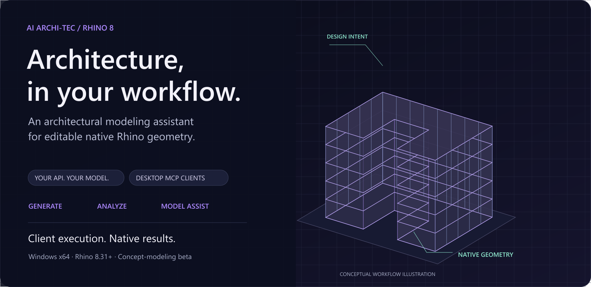
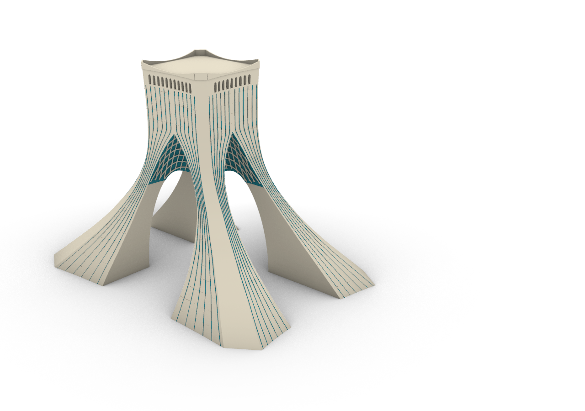
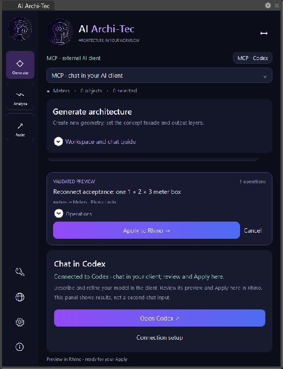
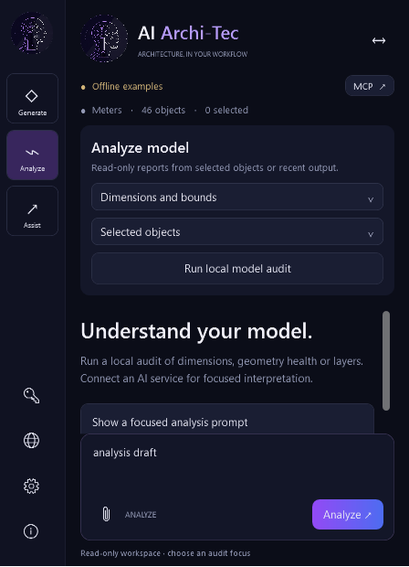

<p align="center"></p>
<h1 align="center">AI Archi-Tec for Rhino 8</h1>
<p align="center">Architectural modeling. Your AI connection. Native Rhino geometry.</p>



<p align="center">
<a href="https://github.com/MrHs6/ai-architec-rhino/releases/tag/rhino-v0.5.0-beta.6"><b>Download for Windows</b></a> ·
<a href="docs/INSTALLATION.en.md">Installation tutorial</a> ·
<a href="docs/MCP-QUICKSTART.en.md">MCP setup</a> ·
<a href="docs/ARCHITECTURE.en.md">Architecture</a> ·
<a href="docs/README.fa.md">فارسی</a>
</p>

[](https://github.com/MrHs6/ai-architec-rhino/actions/workflows/rhino-plugin.yml)


Open **`archtec`** inside Rhino to generate concept geometry, inspect your model or refine selected objects. Connect your own API account for chat in Studio, or use Codex/Claude Desktop through local MCP. In API mode, review a viewport preview and click **Apply to Rhino**. In MCP mode, stay in your AI client: authorize native tool execution there and inspect the result without a local Apply step.

**Concept-modeling beta · Windows x64 · Licensed Rhino 8.31+ within Rhino 8 · .NET 8 runtime.** No shared API key or model credit is included. The ready-made installer needs no developer tools.

## Built with AI Archi-Tec: Azadi Tower



**Modeled in Rhino through AI Archi-Tec MCP, with Codex directing the native modeling tools.** This normal rendered viewport capture shows the final editable model: four flared stone piers, open crossing passages, a curved turquoise vault, stone lattice and crown details. The plugin executed and validated the operations; the conversation and follow-up edits stayed in Codex.

**339 valid closed native Breps · tower only · 45 m overall model height.** This is a photo-based architectural reconstruction with assumed fine dimensions. The image records the actual model delivered below.

**[Download the editable tower (.3dm)](https://github.com/MrHs6/ai-architec-rhino/releases/download/rhino-v0.5.0-beta.6/Azadi-Tower-Reference-Rebuild.3dm)** · [See the modeling workflow and checks](docs/AZADI-MCP-DEMO.en.md) · [View the full-size render](rhino-plugin/docs/azadi-tower-render.png)

## Three workspaces, distinct purposes

| Generate | Analyze | Model Assist |
|---|---|---|
| Create new concept geometry from a request. | Inspect actual dimensions, geometry health and layers. | Move, scale or extrude selected/recent geometry. |
| API facade/layer options; optional supported references. | Local read-only audits work without an API. | Explicit target scope, parameters and a new preview. |
| Preview → Apply → editable native objects. | Optional AI interpretation; no engineering simulation. | Preserve target identity where supported; native Undo. |

Each workspace keeps its own session draft, references and conversation. API profiles, MCP connection, preferences and About are separate pages.

## Design intent → native geometry


The native catalog includes capped NURBS lofts, Brep booleans, sweeps, revolution, pipes, offsets, closed manifold meshes, arbitrary-vector extrusion, validated native geometry payloads, transformations and layer operations, alongside concept buildings and construction curves. Generated buildings have separate slabs, columns and facade parts with role/floor metadata. Model-generated scripts are not executed.

## Install in a few steps


1. **[Download the Windows installer ZIP](https://github.com/MrHs6/ai-architec-rhino/releases/download/rhino-v0.5.0-beta.6/ai-architec-rhino-0.5.0-beta.6-windows-installer.zip)** from Releases.
2. **Extract All**. Keep `install.cmd` beside the included `.yak`.
3. Save your work, close **every Rhino window**, and run **install.cmd**.
4. Reopen Rhino, type **`archtec`**, and press Enter.
5. Choose API chat in Rhino or a desktop MCP client, then create and inspect your first model.

**[Follow the full illustrated installation tutorial →](docs/INSTALLATION.en.md)**

Includes expected results for each step, API/MCP onboarding, first model, checksum verification, custom paths, updates, uninstall and troubleshooting. [راهنمای نصب فارسی](docs/INSTALLATION.fa.md)

The automatically generated **Source code** archives are for developers. Install the versioned Windows ZIP or Yak package. [Release assets and SHA256](https://github.com/MrHs6/ai-architec-rhino/releases/tag/rhino-v0.5.0-beta.6)

## Choose where you chat

| API · Chat in Rhino | MCP · Chat in your AI client |
|---|---|
| Open API profiles, choose a provider, enter your own key and load models. | Open MCP connection, choose Codex/Claude Desktop and click Connect. |
| Select a model, then describe your request in Studio. | Registration is automatic; first setup/upgrade may need one client refresh. |
| Independent endpoint, key, model and persistence per profile. | Client controls execution and inspection; local chat and Apply controls are hidden. |
| OpenAI, OpenRouter, Gemini, Anthropic, xAI/Grok and compatible/local adapters. | Keep the client open: subsequent Rhino MCP off/on reconnects automatically. |

Both routes use native geometry validation and Undo. API uses local preview/Apply; MCP uses client-authorized execution and receipts. Optional MCP previews are applied/cancelled from the client. Opening browser ChatGPT does not register the local bridge. Browser connectors/tunnels require separate setup; this release does not provision them.


**[Technical architecture →](docs/ARCHITECTURE.en.md)** · [MCP setup and recovery](docs/MCP-QUICKSTART.en.md) · [Provider protocols and reference support](docs/PROVIDERS.md) · [Data and credentials](rhino-plugin/PRIVACY.md)

## Earlier interface captures

<table>
<tr>
<td width="50%" align="center"><b>Desktop MCP execution workspace</b></td>
<td width="50%" align="center"><b>Local model analysis</b></td>
</tr>
<tr>
<td align="center"></td>
<td align="center"></td>
</tr>
</table>

Real native UI captures. The interface captures below record the preceding 0.4.2 preview/Apply workflow; the 0.5 MCP route is client controlled. They are workflow evidence, not photorealistic renderings.

<details>
<summary><b>Explore the editable five-floor offline example</b></summary>


This deterministic offline example produces 46 native parts for a 15 × 20 meter concept with five floors and 3.2 meter floor heights. It demonstrates native geometry and organization, not unrestricted AI design quality.

[Download the editable 3DM](https://github.com/MrHs6/ai-architec-rhino/releases/download/rhino-v0.4.1-beta.2/demo-building.3dm) · [Example plan](rhino-plugin/docs/building-plan.json)

</details>

## Verified behavior and beta scope

**144 automated checks pass.** Installed-plugin acceptance builds a tower-only Azadi reconstruction through native tools, audits 339 valid closed Breps, and checks 84 clear passage samples with four positive stone-pier controls. MCP execution stays in the client; API mode retains its own preview/Apply workflow. [Detailed evidence and actual test images](rhino-plugin/docs/VALIDATION.md)

Live paid-provider/vision trials, a real Claude account and a second licensed workstation remain outstanding. This beta does not provide BIM, construction documentation, Grasshopper authoring, photorealistic rendering, engineering simulation or exact reconstruction of arbitrary images. GitHub availability is separate from Food4Rhino/Yak catalog publication.

## Documentation and presentation assets

| Start here | Explore the implementation |
|---|---|
| [Step-by-step installation](docs/INSTALLATION.en.md) | [Architecture and tool contract](docs/ARCHITECTURE.en.md) |
| [MCP connection and recovery](docs/MCP-QUICKSTART.en.md) | [Provider protocols](docs/PROVIDERS.md) |
| [Persian guides](docs/README.fa.md) | [Build and distribution](rhino-plugin/docs/DISTRIBUTION.md) |
| [Editable diagrams and visual kit](docs/design/README.md) | [Validation](rhino-plugin/docs/VALIDATION.md) · [Release notes](rhino-plugin/docs/RELEASE-NOTES.md) |

## Build and contribute feedback

```powershell
git clone https://github.com/MrHs6/ai-architec-rhino.git
cd ai-architec-rhino\rhino-plugin
.\scripts\build.ps1 -UseNuGet
.\scripts\package.ps1
```

Source builds need Windows and .NET SDK 8; the pinned official RhinoCommon SDK is restored from NuGet. Running native UI/geometry acceptance needs licensed Rhino. [Report a reproducible issue](https://github.com/MrHs6/ai-architec-rhino/issues/new/choose) with versions and redacted errors.

Designed and owned by **Hasan Sharif Askari** · [ai-arch.ir](https://ai-arch.ir). Source is available for inspection; an open-source modification/redistribution license has not been granted. Beta binaries are available for public evaluation under [LICENSE.md](LICENSE.md).
