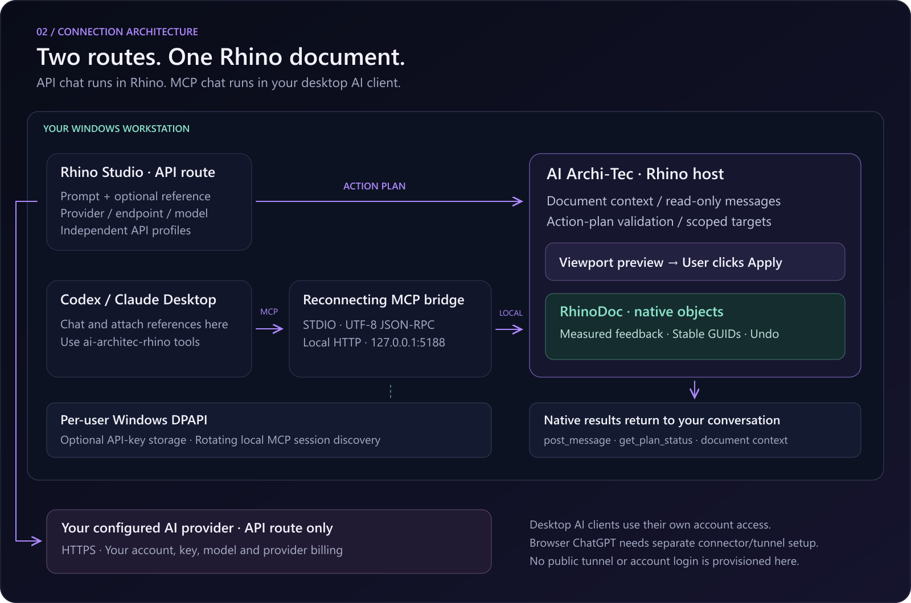

# Architecture and client-controlled execution

The 0.6 candidate extends both routes with bounded editable Grasshopper graph execution. `GrasshopperHost` loads the installed host on explicit graph requests; `GrasshopperBridge` discovers trusted native components, prepares a detached graph, solves on commit and optionally bakes valid native geometry. Graph changes use Grasshopper Undo and bakes use a separate Rhino Undo record. See [the graph contract and workflow](GRASSHOPPER.en.md).

[Overview](../README.md) · [Install](INSTALLATION.en.md) · [MCP workflow](MCP-QUICKSTART.en.md)

| Route | Conversation and planning | Native execution |
|---|---|---|
| API | Studio calls the user's selected provider/model with its own scoped conversation | Structured plan → validation → viewport preview → user Apply → measured result |
| MCP | The external AI client owns prompts, references, reasoning, tool approval and follow-ups | execute_plan → validation → undoable native batch → receipt → client inspection |
| Offline | Limited deterministic numeric examples in Studio | The API/offline preview and Apply path |

MCP does not invoke a provider, run an autonomous agent, reinterpret the prompt or use the API workspace policy to downgrade a client plan. The local composer, workspace controls and commit buttons are hidden. Its log is separate from API conversation histories. Optional MCP previews are committed/cancelled using client tools.

## Modules

| Module | Responsibility |
|---|---|
| ArchiTec.Core | Typed action validation, provider adapters/profiles, MCP catalog/protocol, cancellation, session receipt ledger and DPAPI discovery |
| ArchiTec.Rhino | Document/target checks, native geometry engine, viewport preview, actual measurements/capture, panel and commands |
| ArchiTec.McpBridge | UTF-8 STDIO client surface, authenticated loopback transport, concurrent input/cancellation and automatic reconnection |
| ArchiTec.Tests | Provider/workspace/validation checks, real HTTP cancellation and a real STDIO reconnect/cancellation fixture |
| Packaging | Versioned Yak, per-user installers, registration backup/repair and release checksums |

## MCP surface

| Tool | Role |
|---|---|
| get_context | Active document ID/units/layers and selected/recent metadata |
| get_capabilities | Exact native action parameters and limits |
| get_objects | Explicit object IDs or layer-prefix inspection; validity, closure, bounds, area, volume and bounded point probes |
| execute_plan | Client-authorized native execution with a stable UUID request ID; no local Apply |
| propose_plan / apply_plan / cancel_plan | Optional client-managed viewport preview lifecycle |
| get_plan_status | Processing/applied/cancelled/failed receipt or unknown |
| post_message | Optional status log; no local AI response generation |
| set_view / get_viewport_image | Frame the native result and inspect its actual PNG capture |

The 24 action names and parameter contracts live in [McpCatalog.cs](../rhino-plugin/src/ArchiTec.Core/McpCatalog.cs) and [Contracts.cs](../rhino-plugin/src/ArchiTec.Core/Contracts.cs). Native geometry is implemented in [SurfaceTools.cs](../rhino-plugin/src/ArchiTec.Rhino/SurfaceTools.cs), [SolidOperations.cs](../rhino-plugin/src/ArchiTec.Rhino/SolidOperations.cs) and [GeometryEngine.cs](../rhino-plugin/src/ArchiTec.Rhino/GeometryEngine.cs). No tool executes arbitrary scripts or shell commands.

## Execution, cancellation and receipts

The client reads the document context, supplies explicit units and operands, and sends a unique UUID. Validation precedes geometry preparation. Native operations run on Rhino's UI thread, check target fingerprints/units/tolerance, record one batch Undo, and return actual created/modified IDs. Failed execution rolls back the batch when changes have begun; a rollback failure is reported for inspection.

The bridge keeps reading STDIO while a tool runs. MCP cancellation reaches the HTTP request and operation token. Cancellation is checked before and between native steps; it cannot interrupt every Rhino kernel call or retroactively remove a completed batch. Stopping AI generation when no tool is active simply leaves the bridge idle.

The in-memory receipt ledger binds each execute_plan UUID to the document and plan fingerprint. Repeated identical requests return the receipt. Conflicting reuse is rejected. Receipts survive listener off/on but not panel/Rhino restart. An unknown status after restart requires document inspection. Timeouts and ambiguous failures are never automatically replayed.

## Reconnection and data

Local MCP binds only to loopback with a rotating bearer credential and rejects browser Origin headers. The stable STDIO bridge rereads the current user's DPAPI-protected session descriptor. Tool discovery remains available while Rhino is offline. Pre-dispatch authentication/session rejection may reconnect once; uncertain writes are not replayed. A plugin upgrade changes the executable path and requires one client refresh.

Basic context does not serialize the entire 3DM. An explicit get_objects request can inspect a wider object scope, including hidden objects when requested; an explicit capture returns the active viewport image to that client. The MCP route sends no provider request itself. [Privacy/storage details](../rhino-plugin/PRIVACY.md) · [Validation and remaining limits](../rhino-plugin/docs/VALIDATION.md)
