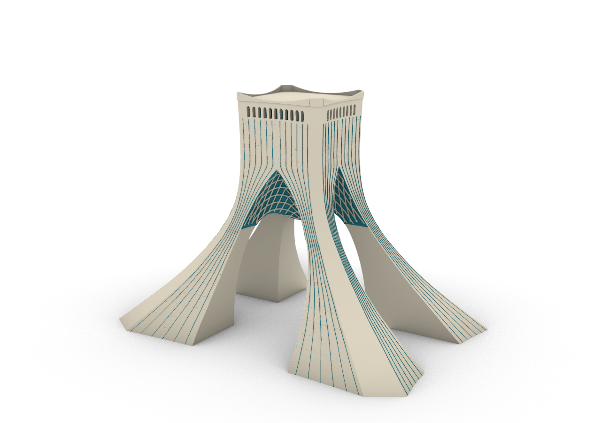
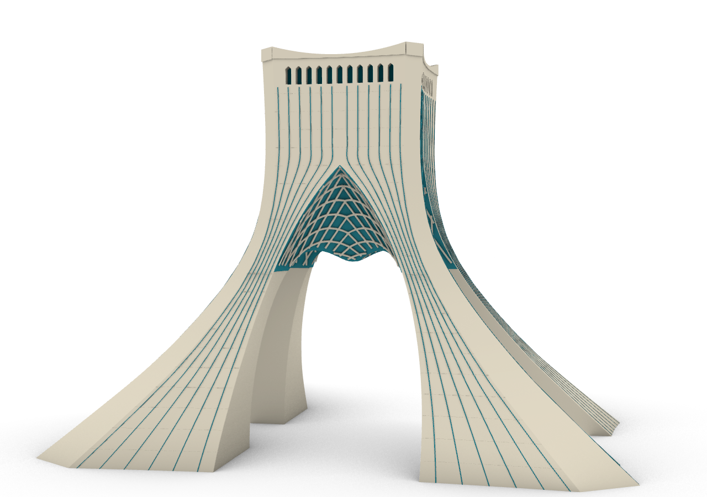
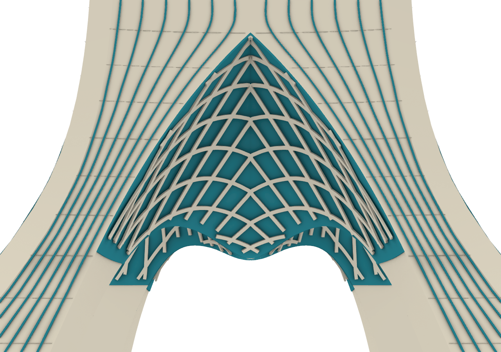

# Azadi Tower — reference reconstruction through MCP

[Project](../README.md) · [Client workflow](MCP-QUICKSTART.en.md) · [Validation](../rhino-plugin/docs/VALIDATION.md)

This is actual geometry built through AI Archi-Tec's MCP tools and captured in Rhino. It is not a generated promotional image, an imported finished model or a wireframe standing in for a building. Codex supplied the modeling operations; the installed plugin validated and executed them. The conversation stayed in Codex throughout.

## The reference brief

Reconstruct **only Azadi Tower**: four flared stone piers, a walk-through central opening, a curved cross vault with turquoise lining and flat stone lattice, continuous facade inlays, pointed crown apertures and an upturned parapet. Omit the plaza, gardens, water and podium. A separate backup preserves the preceding model; the user explicitly authorized its replacement in the working document.

The earlier development trial used an unsuitable flat vault screen and a landscape setting. It was rejected and replaced. The model shown here uses varying three-dimensional arch cutters; its lining follows the actual curved underside and leaves the passage clear.

## Native geometry

| Component | Construction | Final objects |
|---|---|---:|
| Main stone body | Capped envelope loft, crossing spatial cutters, native boolean difference and 40 carved crown apertures | 1 Brep |
| Upper vault lining | Thin closed shell differences, intersections and crossing-void trims | 2 Breps |
| Vault stone lattice | Fitted rectangular-section capped lofts on both vault families | 80 Breps |
| Crown glazing | Recessed pointed polygon extrusions | 40 Breps |
| Upturned crown | Four lofted parapets and four corner stones | 8 Breps |
| Turquoise facade inlays | Continuous thin-section capped lofts | 48 Breps |
| Cladding joints | Subtle native capped pipe details | 160 Breps |
| **Tower only** | **Valid, closed, editable native geometry** | **339 Breps** |

No hidden construction or superseded trial geometry remains in the clean deliverable. The document retains some empty layer names from the preceding project; those are not landscape geometry.

## Inspect the opening

The installed bridge reports all 339 objects valid and closed. Read-only containment checks test **84 points** along the two central crossing paths, between Z 0.5 and 19.5 meters. None lies in the main stone body or the two upper lining solids. Four positive control points fall inside the four stone piers. This is a sampled clearance check, not a continuous swept-volume or accessibility certification.

The turquoise surface and stone network bend in depth from the pointed exterior opening to the lower inner throat. The detail consists of solids, not lines or a flat triangular backing.

## Repeatable client workflow

1. Save a separate backup and read `get_context` plus `get_capabilities`.
2. Send small `execute_plan` batches with distinct UUID request IDs.
3. Inspect receipts and actual objects after each principal loft or boolean.
4. Correct geometry when measurements or viewport captures disagree with the brief.
5. Hide construction sources during development. Delete only explicitly identified, authorized superseded objects after verification.
6. Audit closure, dimensions and passage probes, then capture front and detail views.
7. Save the clean 3DM through Rhino's normal Save As action.

All modeling used the installed AI Archi-Tec native action catalog. A task-owned STDIO client exercised the same advertised tools where the current chat's cached schema had not yet refreshed. No alternate Rhino router, model-generated Rhino script or external geometry-writing library built this tower. MCP did not invoke an API model inside the plugin.

## Dimensions and fidelity

The model uses a **63 × 42 meter base and 45 meter overall height**. The 45 meter height is supported by the [architect's interview](https://www.bidoun.org/articles/hossein-amanat) and the [CTBUH building record](https://www.skyscrapercenter.com/building/azadi-tower/23652). The base proportions and approximately 21 meter inner throat use published secondary descriptions and supplied visual references. The [architect's project photographs](https://amanatarchitect.com/project/shahyad-azadi-monument/) inform the four-pier silhouette and woven vault language.

This is a **photo-based architectural reconstruction**, not an exact surveyed/as-built model. Fine section profiles, facade recesses, cladding and lattice geometry are modeled assumptions. A measured drawing set or survey would be needed to establish exact fidelity. Valid closed solids do not certify structure, fabrication, building regulations or the quality of every future AI output.

[Download the editable tower 3DM](https://github.com/MrHs6/ai-architec-rhino/releases/download/rhino-v0.5.0-beta.6/Azadi-Tower-Reference-Rebuild.3dm)
