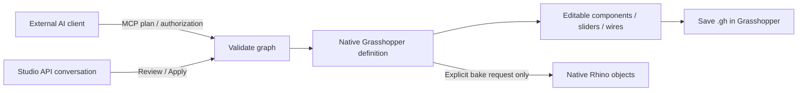
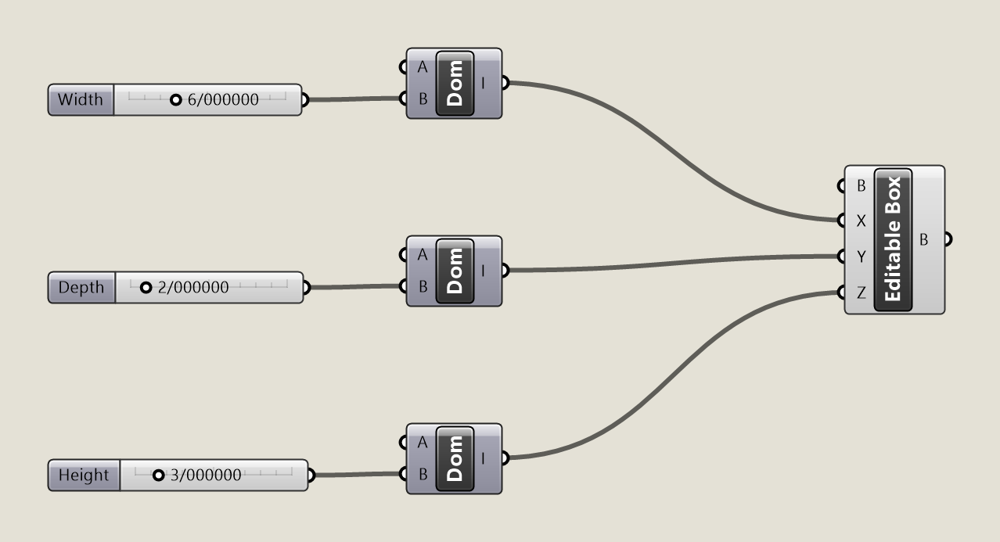

# Grasshopper through AI Archi-Tec

**0.6.0-beta.10 · Windows x64 · licensed Rhino 8.31+ with Grasshopper · .NET 8.** Use the [current release installer](https://github.com/MrHs6/ai-architec-rhino/releases/tag/rhino-v0.6.0-beta.10) linked from the main README. Rhino and Grasshopper support are included in the same installation.

## One installation, one MCP connection

AI Archi-Tec is a Rhino plug-in. Type **`archtec` in Rhino's command line**, not in Grasshopper's component search. Its floating Studio can stay beside the Grasshopper canvas. This revision does not install a separate `.gha`, custom Grasshopper component or Grasshopper command-search entry.

Grasshopper loads when graph inspection, discovery or execution is requested. There is no second Grasshopper server, API account or port to configure. Keep Rhino, the document and the MCP connection open while working.

## MCP: stay in your AI client

1. Install the current release, restart Rhino and run `archtec`.
2. Open MCP connection, choose your supported desktop client and Connect. After an upgrade, refresh that client's MCP tool list once if needed. A running listener alone is not proof of client contact.
3. In the client, request **an editable Grasshopper definition**, its parameters and document units. Start with no bake.
4. The client reads `get_context`, `get_capabilities` and `get_grasshopper_context`, then discovers exact component GUIDs and ports with `search_grasshopper_components`.
5. The client sends a separate `grasshopper_definition` plan through `execute_plan`, with a unique UUID `request_id`. Normal client tool authorization applies; there is no additional Apply click in Rhino.
6. Inspect the returned definition ID, node outputs and component messages. Ask for a change in the same client. Updates use that definition ID and a complete revised graph, without adding a duplicate definition.
7. Request Bake only when you need independent Rhino geometry. Save the graph using Grasshopper's normal Save command.

Example prompt:

> Create an editable Grasshopper box definition in the current Rhino document units. Use independent Width, Depth and Height sliders with values 2, 4 and 3. Wire native components and keep the result parametric; do not bake. Inspect the solved outputs and report errors. On follow-up, modify this same definition rather than creating another one.

MCP does not call an AI provider itself. A compatible external client supplies the model, conversation and approvals. A browser ChatGPT tab does not automatically gain access to Windows localhost. Other MCP clients require manual setup and have not all been account-tested.

Stopping the listener disables new bridge requests. Starting it again allows the registered bridge to rediscover the current session. Client Stop requests cancellation of an in-flight operation; it does **not** undo already committed results. Cancellation is cooperative; a busy native component may take time to return.

## API: work in Studio

1. Run `archtec` in Rhino. Choose **Chat here · API / offline tools**.
2. Choose **Grasshopper · parametric definition** in the target selector.
3. Open API profiles, connect your own supported provider account or compatible local endpoint, load models and select the exact model to use. Provider availability, credentials, pricing and model quality belong to that service. No paid credits are bundled.
4. Describe the definition. Studio sends actual graph context and a bounded installed-component catalog with your conversation.
5. Review the structured definition plan. This is a **graph plan preview**, not a solved viewport preview. Components solve when you click Apply.
6. Continue follow-ups in the same Studio conversation. Bake must be requested explicitly. Rhino and Grasshopper API histories are separate.

Offline numeric Rhino examples do not generate Grasshopper definitions. The shared API adapter supports the existing provider protocols; paid account generation has not been live-tested in this acceptance run.

## Current graph contract

| Capability | Behavior |
|---|---|
| Discovery | Installed native component GUIDs, descriptions and indexed ports |
| Authoring | Components, bounded numeric sliders, typed persistent input branches and wires |
| Inputs | Number, integer, boolean, text, point, vector, XY plane and interval; bounded data-tree paths |
| Updates | Replace an open bridge-created graph in the same Rhino document/session |
| Inspection | Nodes, slider values, source connections, output counts/samples and runtime warnings/errors |
| Bake | Explicit named output nodes; valid native geometry, maximum 1,500 items |
| Undo | Grasshopper Undo/Redo for graph edits; Rhino Undo for baked geometry; separate stacks |
| Save | Normal Grasshopper Save creates an editable `.gh` file |

The graph has at most **200 nodes and 500 wires**, with at most 20 selected bake nodes and 20,000 solved output items. Plans use `length_unit: document`; set meaningful Rhino units before modeling. Do not mix graph and Rhino actions in the same transaction.

Supported installed libraries: **Curve, Surface, Vector, Math, Transform, Triangulation and Field**. This is bounded native graph authoring, not unrestricted access to every Grasshopper add-on. Scripts, clusters, file/network IO, feedback cycles and third-party components are excluded. Arbitrary existing or reopened definitions can be inspected but are not adopted for replacement. Edit ownership is held in session memory, not persisted in `.gh`.

`last_recipe` is the last accepted recipe, not a synchronization of subsequent hand edits or Undo. Read current nodes, slider values, sources and outputs before planning. A changed graph invalidates an already prepared update; request a fresh plan. Graph errors prevent commit; bake errors roll back newly baked objects.

## Work effectively

- State the target, units, adjustable parameters, desired component logic and whether Bake is required.
- Build and inspect a small parametric system first, then add complexity in bounded stages.
- Keep dependencies explicit. Ask the client to discover components instead of guessing GUIDs or port indexes.
- Inspect runtime warnings and output counts as well as the viewport. A graph that exists is not necessarily the intended design.
- Save your `.gh` and `.3dm` normally. Baked geometry does not automatically follow later slider changes.
- After an uncertain execution result, read its receipt using the same request ID; do not blindly repeat a bake with a new UUID.

## Verified release

Native canvas export of the tested API definition, with Width 6, Depth 2 and Height 3 in document units. **[Open the editable .gh example](../rhino-plugin/examples/grasshopper-parametric-box.gh)** · [Fresh graph-plan example](../rhino-plugin/examples/grasshopper-parametric-box.json). The JSON creates the separate MCP fixture (2 × 4 × 3 initially, no bake); the saved API example records its tested follow-up values.

The installed plug-in passed the real packaged STDIO MCP → authenticated localhost → Rhino → Grasshopper path. A seven-node definition was created, updated in place and baked as a valid closed 5 × 4 × 3 meter Brep, volume 60 m³. An identical UUID retry returned the same receipt.

The actual in-Rhino API workflow was tested with a **mock planner**, including preview isolation, Apply, follow-up, bake, graph Undo/Redo, independent Rhino Undo, failed partial-bake rollback and `.gh` export/reopen. See [validation](../rhino-plugin/docs/VALIDATION.md). These tests do not establish all component combinations, live paid-provider behavior or performance on a second workstation.

[راهنمای فارسی](GRASSHOPPER.fa.md) · [MCP setup](MCP-QUICKSTART.en.md)
