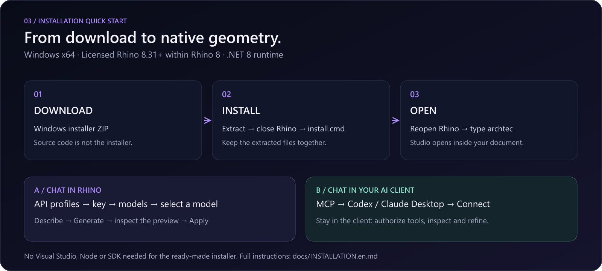
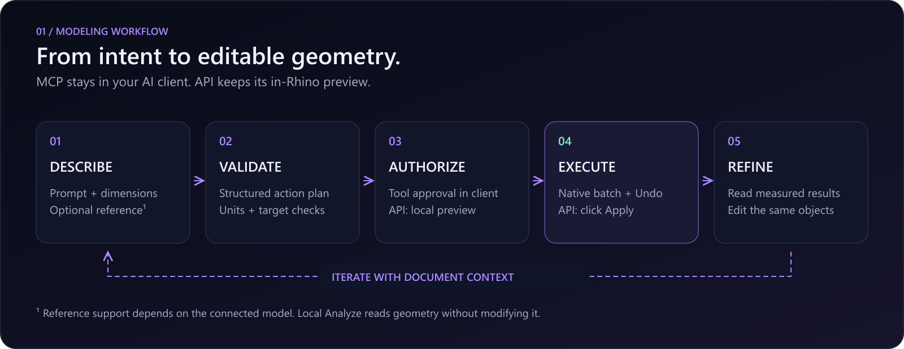

# Install AI Archi-Tec for Rhino 8

[Project overview](../README.md) · [Download 0.5.0-beta.6](https://github.com/MrHs6/ai-architec-rhino/releases/tag/rhino-v0.5.0-beta.6) · [فارسی](INSTALLATION.fa.md)



This guide installs the ready-made Windows plugin. Building the source is a separate developer workflow; no Visual Studio, Node or .NET SDK is needed for this installer.

## 1. Check your workstation

| Requirement | Supported configuration |
|---|---|
| Operating system | Windows x64 |
| Rhino | Licensed Rhino **8.31 or newer within Rhino 8** |
| Runtime | .NET 8 |
| Direct AI chat | Your own provider account and API key |
| Desktop MCP | An installed, signed-in compatible client such as Codex or Claude Desktop |

Use Rhino's version information to check your build. Rhino 7, macOS and earlier Rhino 8 builds are outside this package's supported configuration. You can try the limited offline example before connecting AI.

## 2. Download the installer

Open [the release page](https://github.com/MrHs6/ai-architec-rhino/releases/tag/rhino-v0.5.0-beta.6), expand **Assets**, and download:

**[ai-architec-rhino-0.5.0-beta.6-windows-installer.zip](https://github.com/MrHs6/ai-architec-rhino/releases/download/rhino-v0.5.0-beta.6/ai-architec-rhino-0.5.0-beta.6-windows-installer.zip)**

The automatically listed **Source code (zip/tar.gz)** downloads are for developers, not plugin installers. The separate `.yak` asset is for direct Yak installation.

## 3. Extract all files

In File Explorer, choose **Extract All** for the downloaded ZIP. Open the extracted folder. Keep its files together, including:

```text
install.cmd
install.ps1
repair-registration.cmd
repair-registration.ps1
ai-architec-rhino-0.5.0-beta.6-rh8_31-win.yak
README.md
PRIVACY.md
SHA256SUMS.txt
```

**Expected:** `install.cmd` and the `.yak` file are in the same real folder, not inside the ZIP preview.

## 4. Save your work and close Rhino

Save any open documents, then close **every Rhino window**. A running old plugin cannot be replaced in memory, and an old process can restore an obsolete registration at shutdown.

**Expected:** no Rhino window remains open before installation.

## 5. Run the installer

Double-click **install.cmd** in the extracted folder. It uses Rhino's installed Yak tool, then checks or repairs only this plugin's per-user registration. It does not require administrator access or change PowerShell execution policy.

**Expected:** Yak reports the package installed and the helper reports a valid or repaired Studio registration. Read any failure before continuing; a registration-repair failure is an incomplete installation.

For a custom Rhino installation, use CMD from the extracted folder:

```cmd
set "ARCHITEC_RHINO_SYSTEM=D:\Applications\Rhino 8\System"
install.cmd
```

Replace the example path with your Rhino **System** directory. `install.cmd /check` checks paths only; it does not install or prove startup.

## 6. Open Studio in Rhino

Reopen Rhino, open or create a document, and enter this in Rhino's command line:

```text
archtec
```

Press **Enter**. Studio opens as a Rhino panel. Use **AIArchitectFloat** if you prefer a floating panel. Native preferences are under **Tools → Options → AI Archi-Tec**; plugin loading is under **Tools → Options → Plug-ins**. About shows the actual loaded version and file path.

**Expected:** the English Studio interface has Generate, Analyze and Assist navigation. Opening Studio does not itself connect an AI account.

## 7. Choose where to chat

### Route A — Chat inside Rhino with your API key

1. Open **API profiles** using the key icon.
2. Choose OpenAI, OpenRouter, Google Gemini, Anthropic/Claude, xAI/Grok, or compatible/local.
3. Enter the correct service endpoint and **your own API key**.
4. Enable **Remember securely after restarting Rhino** only if you want encrypted persistence for this Windows user. Otherwise the key stays in the current session.
5. Click **Save this profile** to save and activate it. Saving does not send a modeling request.
6. Click **Connect and discover models**, choose a returned model and save the profile. A network failure does not discard the saved profile.
7. Return to the workspace and use **Chat here · API / offline tools**.

**Expected:** authenticated model discovery succeeds and your selected model is visible. A no-key network test returning HTTP 401 only establishes host reachability; it does not validate your key. Model access and billing belong to your provider account. [Provider protocols and image support](PROVIDERS.md)

### Route B — Chat in Codex or Claude Desktop using MCP

1. Open **MCP connection** using the globe icon.
2. Select **Codex** or **Claude Desktop** and click **Connect**. The plugin starts localhost MCP, registers the installed bridge for this Windows user, and opens the client when available.
3. On **first setup or a plugin upgrade**, refresh Codex's tools once in **Settings → Plugins → MCPs** (refresh beside Servers), or restart the client. Fully quit and reopen Claude Desktop after its configuration changes. Allow the tools if the client asks.
4. In the client, ask: **“Use ai-architec-rhino and call get_context.”**
5. Check Rhino for **Connected · Codex/Claude Desktop**. Then chat and attach references in that client. Authorize native tools there and inspect their receipts; the MCP workspace has no second chat composer or local Apply step.

**Expected:** an actual client handshake and context read, not merely a running server. For later Rhino MCP off/on, keep the client open and click Connect again; the bridge reconnects without another client reload. A plugin upgrade still needs one refresh to load its new executable. [Detailed MCP guide](MCP-QUICKSTART.en.md)

Browser ChatGPT is a separate connector/tunnel workflow. Opening its website or pasting a configuration into chat does not register the local bridge. This release does not provision a browser connector, account login or public tunnel.

## 8. Create your first model

For a deterministic test without an API account, use the API/offline route and the **Try a five-floor building example** button, or submit this numeric example:

```text
Create a 15 x 20 meter building with 5 floors and 3.2 meter floor heights and a glazed facade.
```

For MCP, use the [client-only first modeling request](MCP-QUICKSTART.en.md#first-modeling-request): read `get_context` and `get_capabilities`, then `execute_plan`, `get_objects` and `get_viewport_image`. Authorize the modeling tools in that client; no Rhino Apply click is needed. The steps below apply to the API/offline route.



1. Inspect the validated preview and its dimensions in the active Rhino document.
2. Click **Apply to Rhino** yourself to create the native objects. **Cancel** leaves the proposal unbuilt.
3. Read the measured result. The API conversation can continue from this measured result.
4. Use **Zoom Extents** if the geometry is outside the current view. Use **Ctrl+Z in Rhino** to undo the applied batch.

The offline parser understands limited numeric examples. Free-form requests require an online model; a reference image is not a promise of exact reconstruction.

## 9. Analyze or refine the result

- **Analyze:** choose Selection or Recent output, select Dimensions, Health or Layers, and run the local read-only audit. This needs no API and makes no geometry changes.
- **Assist:** choose selected objects or recent output. Use Move, Scale or Extrude controls in the API route, or request a scoped edit in your MCP client. In API mode review and Apply the new preview. In MCP, all follow-ups stay in the external client.
- **Generate:** create new geometry. Each workspace keeps its own session conversation and draft. Switching workspaces cancels the current preview.

## Update, verify or uninstall

For an update, save documents, close all Rhino windows, install the new ZIP and reopen Rhino. Personal settings remain under the same Windows account. Run Connect once after a plugin upgrade to update the client bridge path, then refresh the client once.

When PowerShell is permitted by your device policy, run `install.ps1 -CheckOnly` to check Rhino/package identity and the bundled checksum; `install.ps1` installs. To check a downloaded asset manually:

```powershell
Get-FileHash .\ai-architec-rhino-0.5.0-beta.6-windows-installer.zip -Algorithm SHA256
```

Compare with **SHA256SUMS.txt from that same release**. The ZIP's internal checksum file covers its extracted files. The direct `.yak` may be installed using Yak or dragged onto Rhino; existing manually registered prototype users should use the ZIP installer so registration is repaired.

Uninstall through Rhino PackageManager, or run:

```cmd
"%ProgramFiles%\Rhino 8\System\Yak.exe" uninstall ai-architec-rhino
```

Restart Rhino afterward. Optional per-user API settings are retained. Public PackageManager search requires a separate Yak catalog publication; use this release's files until that listing is available.

## Troubleshooting

| Symptom | Next action |
|---|---|
| `Unknown command: archtec` or empty/old panel | Close all Rhino windows and rerun the ZIP installer. Check its registration result and the loaded version/path in About. Do not load a second `.rhp` manually. |
| `ID already in use` | Another build of this plugin is already loaded. Save, close Rhino, use the current ZIP installer and restart; do not repeatedly load duplicate copies. |
| Rhino not found | Supply your custom System path as shown in step 5. Check Rhino 8.31+ and .NET 8. |
| API profile saves but cannot connect | Test host reachability, then check endpoint, key, account credit and model compatibility. Storage and network status are independent. |
| MCP waiting for a client | Complete the initial client refresh/reopen, permit tools and call get_context through ai-architec-rhino. A server by itself is not a connected AI account. |
| MCP offline after stopping it | Click Connect in Rhino; keep the existing client open, then retry get_context. Do not blindly resend a timed-out model request. |
| MCP cannot bind its port | Use a free port under Manual setup and diagnostics. Only one local server can own a port; change the client's setup if the port changes. |
| No geometry after Generate | Check the preview; Apply is required. If already applied, check the result and use Zoom Extents. |
| Old proposal rejected | The document, units or target geometry changed; request a fresh plan. |

For support, [open an issue](https://github.com/MrHs6/ai-architec-rhino/issues/new/choose) with Rhino/plugin versions, exact error and reproduction steps. Remove keys, tokens and private model data. [Validation record](../rhino-plugin/docs/VALIDATION.md) · [Privacy](../rhino-plugin/PRIVACY.md)
