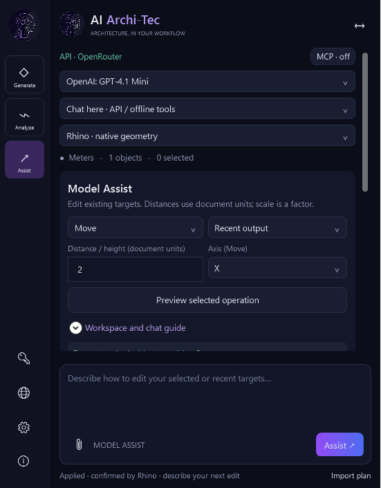
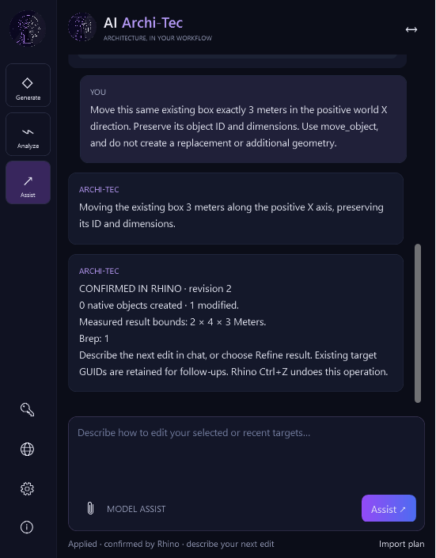

# MCP continuity validation — 0.6.0-beta.10

199 automated core/protocol checks and 15 installed native checks pass. The native fixture verifies hidden-panel continuity, repeated inspection of the same GUID, preserved listener/discovery, idle status, pagination and an isolated closed-solid edit. No user-document geometry was changed and no cloud inference was requested. [Sanitized native record](acceptance/mcp-lifetime-beta10.json) · [Detailed workflow and scope](../../docs/MCP-CONTINUITY.md).

## Earlier release validation (historical)

# Validation — AI Archi-Tec 0.6.0-beta.9

## API and workspace acceptance — 25 October 2026

- **196 automated core/protocol checks pass.** Provider HTTP fixtures cover credential, credit, budget, region, gateway, routing, schema and upstream errors without returning raw sensitive bodies. OpenRouter authenticates `/key` before public model discovery. Regression cases preserve existing-object scope when an edit forbids creating replacements or requests new dimensions/position.
- Installed the final ten-file Yak in licensed Rhino 8.31 on Windows. The installed RHP SHA256 matches the tested build. Official pinned SDK solution build and native runtime-helper build complete with zero warnings/errors. The package excludes host SDK assemblies, profiles and credentials.
- **Nine real OpenRouter workflow checkpoints pass**, using the saved encrypted profile and explicitly selected `openai/gpt-4.1-mini`. Authenticated discovery returned 389 compatible models at test time. A Persian greeting returned text without a plan or geometry. A live create-box response produced a preview before Apply; Apply created one valid closed native Brep measuring **2 x 4 x 3 meters**, volume **24 m³**. A second live model request moved the same object +3 meters along X, preserving its UUID and dimensions. The saved 3DM reopens with exactly one object. Three inference requests were made in this final run; no mock planner, alternate model or custom network transport was used.
- **39 native WPF layout checks pass** at 560 x 780, 420 x 640 and 350 x 540. Connection controls, options, history and previews share a scrolling workspace; brand and multiline composer stay fixed. Generate, Analyze, Assist, Grasshopper, MCP and API-profile model display are covered. Closed model selectors display a readable name, and a stale catalog cannot reappear after failure.
- The preconnection Send check proves that a saved profile cannot silently run offline examples. The standalone failure fixture is available for an existing real failed Connect; it is not counted as passed in this successful final session. Failure transport coverage remains automated/simulated.
- Final installed **0.6.0-beta.9 Grasshopper retest passes**: the actual STDIO MCP bridge discovers native components, creates seven nodes/six wires without baking, returns the identical receipt for a repeated request UUID, updates the same definition and bakes one valid closed 5 x 4 x 3 meter Brep (volume 60 m³). **19 in-Rhino API workflow checks pass with a mock planner**, including preview isolation, Apply, same-graph follow-up, native baking, independent Grasshopper/Rhino Undo, Redo, failed-bake rollback and editable `.gh` export/reopen. Live listener Stop/Start also preserves both definitions and the same running bridge process, with an actionable offline result while stopped and no client Reload. These graph API checks do not use a paid model; the separate nine-check live OpenRouter run above does.
- The initial 403 also affected anonymous API requests and temporarily the browser account page. Restoring the user's normal network connection made the official endpoint reachable; the same saved key then completed real authentication/inference. The plugin did not alter VPN/proxy settings, disable TLS validation or bypass provider access policy. The documented .NET 8 proxy snapshot is a troubleshooting condition, not proof of the sole cause of every 403.
- Other providers have protocol-fixture coverage, not live personal-account acceptance in this revision. Live vision, second-workstation installation and paid-provider Grasshopper graph generation remain unverified. This record validates the 0.6.0-beta.9 implementation. GitHub releases, Food4Rhino downloads and the public Yak catalog are separate distribution surfaces.

[Sanitized live report](acceptance/api-live-beta9.json) · [Layout measurements](acceptance/ui-layout-beta9.json) · [Core test output](core-test-results.txt) · [Reproduction instructions](../tests/ArchiTec.RuntimeTests/README.md)

[Grasshopper API runtime report](acceptance/grasshopper-runtime-beta9.json) · [Live MCP reconnect report](acceptance/grasshopper-reconnect-beta9.json)

---
# Historical validation — AI Archi-Tec 0.6.0-beta.6 candidate

## Grasshopper acceptance — 25 October 2026

- **165 automated tests pass.** Includes graph isolation/document units, zero-based runtime IDs, duplicate/malformed input rejection, DAG topology, typed schema, API target policy, provider transport fixtures and the existing real STDIO cancellation/reconnect tests.
- Installed the final Yak in licensed Rhino 8.31 on Windows. Local SDK and pinned official NuGet SDK builds both complete with zero warnings/errors. Packaging verifies ten expected payload files and excludes Rhino/Grasshopper SDK binaries and user settings.
- Real packaged STDIO MCP → authenticated loopback → installed plug-in → native Grasshopper: discover actual GUIDs/ports, create seven nodes/six wires without baking, repeat the UUID with an identical receipt, update the same definition (runtime ID zero) and bake one valid closed native Brep. Measured bounds: [0,0,0]–[5,4,3] meters; volume 60 m³; area 94 m².
- **19 in-Rhino API checks pass using a mock planner**, not a paid provider. They exercise target-specific help, actual context/catalog, pending graph-plan isolation, Apply, same-definition follow-up, one valid closed 6 × 2 × 3 Brep (volume 36), preservation of earlier MCP geometry, graph Undo/Redo, independent Rhino Undo, rollback after a partially successful bake, unchanged graph after failed bake and `.gh` export/reopen.
- The returned `.gh` file contains all seven native nodes and can be reopened in Grasshopper. Bridge edit ownership is intentionally session-only; reopened arbitrary files are read-only through this graph-replacement surface.
- Live listener Stop/Start preserved both open definitions and the same running STDIO bridge process. A request while stopped returned the actionable offline response; the next request after Start succeeded without client Reload or re-registration. No geometry request was replayed.
- Unsupported: arbitrary scripts, third-party components, feedback cycles, arbitrary graph adoption and unrestricted host access. Native solver cancellation is cooperative. These checks do not establish every component combination or design accuracy.
- Live paid API/vision generation, other client account workflows and another workstation remain unverified. Public 0.5 release/catalog links remain separate from this source candidate.

See [Grasshopper guide](../../docs/GRASSHOPPER.en.md) and [runtime reproduction instructions](../tests/ArchiTec.RuntimeTests/README.md).

---

# Historical validation — AI Archi-Tec 0.5.0-beta.6

## Automated and installed-plugin evidence (23 October 2026)

- Solution build: zero warnings/errors; **144 automated checks passed**. Coverage includes real HTTP and STDIO cancellation, continued input processing during Stop, request recovery, three server/credential rotations, UUID deduplication/conflicts, typed geometry boundaries and provider/workspace regressions.
- The official Yak installer installs the versioned package and repairs only this plugin's per-user registration, preserving other plugins and credentials. Rhino's startup identifies the loaded version and package path.
- MCP executes client-authorized native batches without a local Apply click or a second chatbot. API chat remains independent. No paid model API was called by the MCP modeling test.
- A verified document backup preceded explicit user-authorized replacement of 515 old objects. The first deletion trial exposed a hidden-object bug, which was fixed. Six native deletion batches then removed the old model successfully.
- The corrected tower was built through native lofts, extrusions, booleans, copy/scale, pipe details and explicit visibility/deletion. An offset trial was correctly reported as open and was not used as the finished lining.
- The saved/reopened tower has **339 visible Breps, all valid and closed**, with no hidden construction or landscape. The body spans 63 × 42 meters in plan and rises to Z 43.8; its upturned crown reaches Z 45.0. These are selected reconstruction dimensions, not survey results.
- **84 read-only containment samples** across both central paths, Z 0.5–19.5, lie outside the main stone and upper lining. Four positive controls lie inside the four piers. Sampling is not continuous clearance certification.
- Front, three-quarter and close vault captures come from the actual Rhino viewport. Explicit camera/target framing was corrected after inspection revealed the old method retained the preceding direction.
- Installed beta.6 rollback acceptance deliberately hid a temporary test solid and then tried to select it. The batch failed, restored visibility with native Undo, and the next move operation succeeded. The fixture was removed and the count returned to 339. This reproduced and verified the modeless Undo-scope fix.
- The initial GUI registration failure was resolved by preferring the desktop-managed Codex CLI over the inherited PATH launcher. In installed beta.6, clicking **Connect to Codex** in Rhino saved the MCP setup and opened Codex; the panel displayed **Setup saved for Codex** and authenticated client contact. The exact same registered bridge passed the geometry and rollback acceptance. A live Disconnect returned the expected offline response; clicking the now-visible Enable connection restored this same client without Reload or repeated registration. The final count remained 339.

[Modeling details and accuracy limits](../../docs/AZADI-MCP-DEMO.en.md) · [MCP workflow](../../docs/MCP-QUICKSTART.en.md)

Live paid API/vision generation, a real Claude account and a second licensed workstation remain unverified. API transport tests use mocks. Native acceptance of these operands does not establish every possible kernel case, exact image reconstruction, engineering correctness or construction readiness. Receipts are session memory, not a persistent operation database.

## Historical records — earlier workflows below used local Apply

# Validation — AI Archi-Tec 0.4.2-beta.1

## Evidence for 0.4.2-beta.1 (22 October 2026)

- Build: zero warnings/errors, 122 automated checks passed. Added real-process STDIO tests initialize/discover tools before Rhino starts, recover passively, survive three server/token rotations, preserve UTF-8, deliver messages once, avoid replaying rejected plans and close the authenticated session on EOF. Claude configuration merging preserves unrelated settings and rejects malformed roots.
- Installed all 10 package files and verified their SHA256 against the final Yak. Fresh Rhino 8.31 loaded the 0.4.2 RHP from its installed package path.
- Clicked the actual Connect to Codex button. It registered the new installed bridge using the official CLI and opened the client. Its Settings showed the correct 0.4.2 path and port, with other servers preserved. One initial desktop MCP refresh loaded the upgrade into this existing chat.
- Actual Codex tools read the empty Meters document, then Rhino's Disconnect button stopped the listener. get_context returned the new actionable offline tool error. Clicking Connect in Rhino restored get_context without any client reload or configuration copy. Both bridge process IDs (16784 and 21636) remained unchanged through that cycle.
- post_message returned to the panel. A real propose_plan from this chat produced request 87f0ca3d-8dad-46a1-b462-bba95e028722 for one 1 × 2 × 3 meter box in document 268435457. The user clicked Apply. Native get_plan_status returned applied, created GUID 80af25e6-a96e-44ad-8c31-48e019106c53, no modifications, Undo serial 2. get_context confirmed exactly one Brep with bounds [0,0,0]–[1,2,3] meters. Codex posted the measured confirmation back into Rhino.
- A second native off/on after Apply preserved the exact same single Brep GUID and bounds, and the original request remained applied. No model request was replayed and no duplicate was created; no manual client reload was used.
- The installed MCP workspace has no PromptInput composer, API connection label or Generate/Assist API option controls in its visible UI. It shows Chat in Codex, actual connection contact, Open Codex and the native preview/Apply card. Fixed labels and guides are English.
- The obsolete 0.4.1 package was archived with all 10 file hashes verified before removing only that version directory. New 0.4.2 is the sole active package version.
- Live Claude account, paid API/vision, second-workstation installation and Food4Rhino/Yak catalog submission remain untested or unpublished. Codex's live local tools are verified; this is not a claim that browser ChatGPT is automatically connected.

## Historical revision evidence
# Validation — AI Archi-Tec 0.4.1-beta.2

## Evidence for 0.4.1-beta.2 (22 October 2026)

- Solution build: zero warnings/errors; **94 automated checks passed**. New tests exercise authenticated initialization, session headers, announced-client identity, tool discovery, status polling, disconnect, token-free JSON/TOML exports, Windows DPAPI discovery and the real stdio executable.
- The installed `0.4.1-beta.2` RHP loaded in a fresh Rhino 8.31 process. The preceding local test packages were archived with per-file SHA256 verification before removal. Public 0.4.1-beta.1 was not released.
- **9 native MCP UI checks passed**: English workspace guides, separate Codex/Claude setup, honest web-connector guidance, Copy for MCP semantics, independent API status and separate client/stage/last-contact displays.
- **8 installed bridge-to-Rhino checks passed**: encrypted discovery, initialize, four tools, active empty document, a real post_message in the panel, awaiting-approval proposal, actual announced test-client name, cancelled proposal status and clean disconnect. No active geometry was created or modified; the acceptance client was explicitly named as a protocol test, not Claude/ChatGPT.
- **19 workspace/audit, 19 native geometry and 11 isolated profile checks passed again** on this installed revision. No personal profiles were changed.
- New UI captures show the real English interface. The MCP image uses a live local protocol-test handshake, not a signed-in Claude/Codex/ChatGPT account. Prior building images and the downloadable example remain limited offline geometry demonstrations.
- No paid API key was used. Live provider generation/vision and a real external AI account still need account-based acceptance. The web/tunnel path is documented, not provisioned or claimed to be connected.

## Prior revision record
## Current revision

- Generate, Analyze and Model Assist have independent session drafts, reference attachments, histories and option controls. Switching cancels the single active viewport preview.
- Generate creates new geometry with facade/layer controls. Analyze is read-only and provides local dimensions, geometry validity/closure and layer reports. Assist offers selected/recent scopes and deterministic Move/Scale/Extrude previews.
- Connection overview, API profiles, MCP connection, Preferences and About are separate opaque pages. MCP starts explicitly. The supplied original logo is embedded and displayed at navigation, header and About sizes through layout clipping, without modifying the original artwork file.
- Six independent provider profiles: OpenRouter, OpenAI, xAI/Grok, Google Gemini, Anthropic/Claude and compatible/local. Native Gemini/Anthropic protocols, model pagination, headers, image formats and structured outputs were implemented from the official references linked in docs/PROVIDERS.md.

## Evidence for 0.4.0-beta.1 (21 October 2026)

- The Windows/.NET 8 solution builds with zero compiler errors and warnings. **80 automated core/provider/MCP/workspace checks passed**; provider requests use mocks, not paid credentials.
- A fresh Rhino 8.31 process loaded the installed `0.4.0-beta.1` package and opened the native `archtec` panel. Only that package version remains in the active package directory.
- **19 workspace/profile/audit checks passed**: independent modes and pages, six providers, original embedded logo, real dimensions/health/layer audits and encrypted credential isolation.
- **19 geometry checks passed** in headless documents: preview isolation, exact dimensions and volume, stable GUIDs, unaffected targets, native Undo, stale targets/units, locked geometry, curves and capped extrusion.
- **11 profile synchronization checks passed** in isolated temporary settings with fixture credentials. Saving OpenAI makes it active; Remember-off clears both disk copies but retains a session key; other providers remain intact; save and network statuses are independent. Personal profiles were not changed.
- **9 conversational checks passed in the active empty document**, scheduled on Rhino Idle after the script command finished. The offline example creates 46 native parts; Apply reports measured 15 × 20 × 16 meter bounds. A Persian follow-up moves only 10 fifth-floor parts by +2 meters in world Y, preserves all GUIDs and leaves 36 parts unchanged. Undo restores positions and chat detects the change. The example remains available in `demo-building.3dm`.
- **Live connectivity from Rhino was verified without a key**: OpenRouter `/models` returned HTTP 200; OpenAI `/models` returned HTTP 401. On the owner's workstation, one explicit outbound Windows Firewall block for Rhino.exe caused socket error 10013. The owner authorized disabling only that exact rule; Domain, Private and Public firewall profiles remain enabled. This workstation repair is not part of the installer or plugin.
- The first diagnostic script incorrectly blocked Rhino's UI thread while awaiting network I/O; the empty test process was restarted, and the successful probe ran on a worker task. The production connection UI uses asynchronous event handlers and cancellation.
- New captures are actual installed WPF views and the native Rhino viewport. The demo is a limited offline example, not proof of live AI model quality.

## Earlier startup repair

The preceding 0.3.0-beta.2 acceptance established that the empty gray panel and unknown `archtec` command came from legacy manual registration. Obsolete versions and the prototype package were archived and SHA256-verified before removal. A clean process loaded the installed Studio/Contracts assemblies, the native Options page and command worked, and 19 workspace plus 19 geometry checks passed. Installers now require Rhino to be closed and repair only this plugin's registration with a per-user backup. That repair is retained in 0.4; the evidence above is the new revision's test record.
## Remaining acceptance

- No real provider key was supplied for this revision. Live Grok/Gemini/Anthropic/OpenRouter/OpenAI requests and image quality still require the user's account-based trial. Passing mocks does not establish live account/model compatibility.
- Clean-start acceptance now passes on the owner's workstation. Installation on a second licensed Windows/Rhino workstation remains outstanding.
- A real external desktop AI account was not connected. Local MCP HTTP and the bridge protocol were tested directly; cloud-to-localhost access still needs a compatible local client.
- UI screenshots and local reports demonstrate real implemented behavior. Thermal, structural, regulatory or daylight analysis, unrestricted image reconstruction, BIM, Grasshopper and persistent project memory are not provided.
- Public GitHub release status is visible in Releases/Actions. Food4Rhino/Yak catalog publication is separate and has not been performed.
